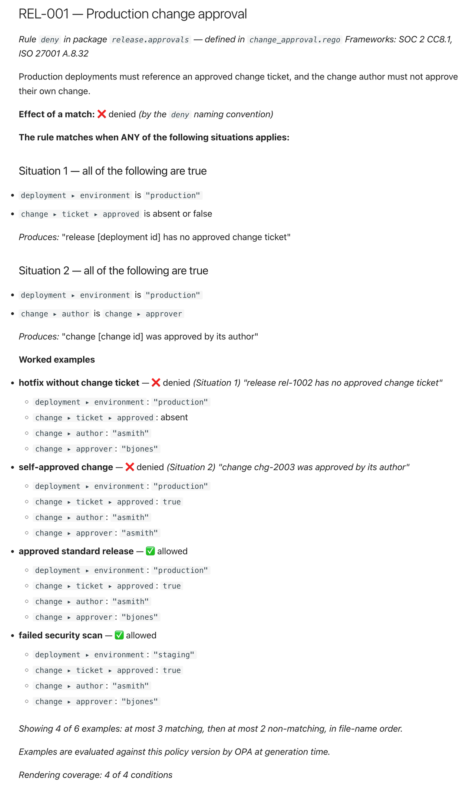

# explico

**Turn your Rego policies and a few example inputs into living documentation that is true by construction.**

explico reads [OPA](https://www.openpolicyagent.org/) Rego policy files and their standard `# METADATA`, and writes plain-language control documents that a
control owner, an auditor or a new engineer can read. Your example inputs are run through the real `opa`, so each document shows what the policy *does today*,
not what someone remembers it doing. Regenerate it in CI and the documentation can never be quietly out of date. It also compares two versions of a policy set and
tells a reviewer, in plain words, what changed.

It is for the people who own a control, the people who have to evidence it, the engineers who write the policies, and the pipelines that gate them. (*explico* is
Latin for "I unfold, I explain", the counterpart to *rego*, "I govern".)

## From this

A rule, as the policy author wrote it. (A **card** is the section generated for one rule; a **situation** is one way the rule can match. More terms are in the
[glossary](docs/glossary.md).)

<!-- excerpt: samples/policies/approvals/change_approval.rego -->
```rego
deny contains msg if {
	input.deployment.environment == "production"
	not input.change.ticket.approved
	msg := sprintf("release %v has no approved change ticket", [input.deployment.id])
}

deny contains msg if {
	input.deployment.environment == "production"
	input.change.author == input.change.approver
	msg := sprintf("change %v was approved by its author", [input.change.id])
}
```

## To this

What the control owner reads (generated; nothing here was written by hand):

<!-- excerpt: docs/sample-output/release-approvals.md -->
```markdown
### Situation 1 — all of the following are true

- `deployment ▸ environment` is `"production"`
- `change ▸ ticket ▸ approved` is absent or false

*Produces:* "release [deployment id] has no approved change ticket"

### Situation 2 — all of the following are true

- `deployment ▸ environment` is `"production"`
- `change ▸ author` is `change ▸ approver`

*Produces:* "change [change id] was approved by its author"

**Worked examples**

- **hotfix without change ticket** — ❌ denied *(Situation 1)*
  *"release rel-1002 has no approved change ticket"*
  - `deployment ▸ environment`: `"production"`
  - `change ▸ ticket ▸ approved`: absent
  - `change ▸ author`: `"asmith"`
  - `change ▸ approver`: `"bjones"`
- **self-approved change** — ❌ denied *(Situation 2)*
  *"change chg-2003 was approved by its author"*
```

Each verdict above came from running `opa eval` on a small JSON file named "hotfix without change ticket". That file is the whole cost of the example.

The whole card, as a reader sees it once the Markdown is displayed (a screenshot; explico itself writes Markdown):



See it live: [the rendered page on the documentation site](https://wakaleo.github.io/explico/sample-output/release-approvals/), or the generated
[`release-approvals.md`](docs/sample-output/release-approvals.md) as GitHub displays it. Both are the real output, checked against a fresh render in CI.

## What happens to Rego it does not understand

explico never describes logic it did not check. When it meets a construct it has no faithful template for, it shows the **verbatim Rego**, clearly marked, and counts it
against the rendering coverage printed on every card, package and the index:

````markdown
- ⚠ **not rendered — shown as source:**

  ```rego
  count({r | some r in input.regions; net.cidr_is_valid(r)}) > 3
  ```

*Rendering coverage: 0 of 1 conditions*
````

That is the whole trade: a document that is occasionally a block of source, and never a sentence that is not true.
[How that works →](docs/concepts/true-by-construction.md)

How much it understands depends on the policy. The sample policies render at 100% because they were written with explico in mind. On public libraries written by other
people it rendered **57% to 88% of conditions**, depending on how much the policies lean on helper libraries and builtins (Gatekeeper 88%, Trivy 66% to 83%, Regal's own
rules 57%; the rest is shown as marked source). Measure your own set before you rely on it:
[Evaluating explico](docs/evaluating.md) has the risks, the limits and a two-week pilot, and [Coverage](docs/concepts/coverage.md) has the figures and how they were taken.

## Why you can trust it

- **True by construction.** Every statement is derived mechanically from the Rego and its METADATA. It never paraphrases or guesses.
- **Deterministic.** The same inputs give byte-identical documents, so a change in the text is always a change in the policy.
- **It drives the real `opa`.** There is no second Rego parser to disagree with the one you enforce with. [Relationship to OPA](docs/concepts/relationship-to-opa.md).
- **It says what it did not understand.** Coverage is counted, not estimated, and CI can enforce a threshold.
- **What it does not prove.** The title, description and control id are whatever the author wrote, and a worked example shows what the policy does on *that* input.

## What you get

- A **control card** for every rule (title, description, control id, frameworks, what a match means, every condition in plain words, worked examples), one document per package and an
  **index** with a framework-to-controls matrix and documentation-quality findings.
- **`explico diff`**: what changed between two versions of a policy set, in plain words, insensitive to formatting, comments and variable names, with the outcome changes on your examples.
- **CI gates** (`--fail-under`, `--fail-on-gaps`, `diff --fail-on`), **JSON** for dashboards and GRC tools, **source links** to the exact Rego line, **one page per control** for a control split over
  several files, and **masking** of sensitive values in examples.

## Try it

You need a JDK (17 or newer) and [`opa`](https://www.openpolicyagent.org/docs/latest/#running-opa) 1.x on your `PATH`. Download the jar from the project's
[GitHub Releases](https://github.com/wakaleo/explico/releases), rename it, and run the built-in demo from an empty directory:

```sh
mv explico-*-all.jar explico.jar
java -jar explico.jar demo
```

```text
Rendered 6 documents to explico-demo/docs/ (100% coverage).
Open explico-demo/docs/release-approvals.md to see a rendered control card.
```

Open `explico-demo/docs/index.md` too: every rule across the six documents, each title linked to its card, with a *Rendered* column and a controls-by-framework matrix.
No `opa` on your `PATH`? Add `--fetch-opa`, and explico downloads a pinned, checksum-verified build itself. `demo` refuses to overwrite an existing `explico-demo` directory
(exit `1`), so remove it to run again. [Install and first run →](docs/install.md)

Then render your own policies:

```sh
java -jar explico.jar render policies --out policy-docs --examples examples
java -jar explico.jar diff policies-old policies-new --out change.md --examples examples
```

`--out` is emptied before each render, so keep it dedicated to generated documents. Every flag and exit code is in the [user guide](docs/user-guide.md).

### As a library

Published to Maven Central as `io.github.wakaleo:explico`, for Kotlin and Java (Java 17 or newer; the consuming project needs Kotlin 2.3.0 or newer if it is Kotlin).

```kotlin
// build.gradle.kts
dependencies {
    implementation("io.github.wakaleo:explico:1.0.0")
}
```

```kotlin
import io.explico.Explico
import io.explico.RenderOptions
import java.nio.file.Path

fun main() {
    val policySet = Explico.load(Path.of("samples/policies"))
    val examples = Explico.loadExamples(Path.of("samples/examples"))
    val rendered = Explico.render(
        policySet,
        RenderOptions(examples = examples, dataDir = Path.of("samples/data/release/data.json")),
    )
    println(rendered.files["release-approvals.md"])
    println("Coverage: ${rendered.coverage.percent}%")

    // diff() takes two loaded PolicySets -- substitute your own old/new checkouts in practice.
    // Diffing samples/ against itself is a real, runnable no-op: every control comes back UNCHANGED.
    val report = Explico.diff(policySet, policySet)
    println(report.markdown)
}
```

See [CLI and library](docs/user-guide.md#library) and [Use from Java](docs/how-to/use-from-java.md).

## Status: 1.0

The library API, the CLI options and exit codes, and the JSON schemas are stable and follow [semantic versioning](https://semver.org); the Markdown wording and layout are not.
[Compatibility](docs/compatibility.md) lists exactly what is promised, and `api/explico.api` and `api/explico.cli` pin it mechanically. It is developed and tested against `opa` 1.19.0.

## Documentation

- [Quickstart](docs/quickstart.md): five minutes, one rule, one card.
- [Tutorial: your first policy](docs/tutorial-first-policy.md): fix a fallback, add METADATA and examples, set a quality gate, review a change.
- [Showcase](docs/showcase/README.md): real output for Kubernetes, storage, API authorization and more, with the Rego beside it.
- [Writing policies](docs/policy-authoring.md) and [From Rego to living documentation](docs/guides/living-documentation.md): the policy author's and the CI owner's guides.
- [User guide](docs/user-guide.md), [JSON output](docs/json-output.md), [CI recipes](docs/guides/ci-recipes.md) and [Troubleshooting](docs/troubleshooting.md).
- [Evaluating explico](docs/evaluating.md) and [Compatibility](docs/compatibility.md).

The full site, with every page, is built from the `docs/` directory.

## Security

Rendering **without** `--examples` only parses your Rego, so it is safe on untrusted policies. Rendering **with** worked examples runs `opa eval`, which *executes* the policy (and Rego
can call out through builtins like `http.send`): do not generate examples for policies you do not trust. Details, and how to report a vulnerability, are in [`SECURITY.md`](SECURITY.md).

## Contributing and licence

Development conventions and how to add a builtin's rendering are in [`CONTRIBUTING.md`](CONTRIBUTING.md). Apache License 2.0, see [`LICENSE`](LICENSE).

explico is not affiliated with or endorsed by the Open Policy Agent project or Styra.
